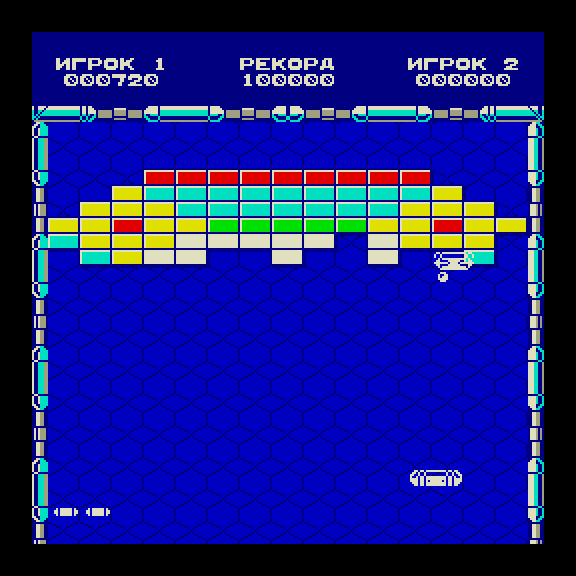
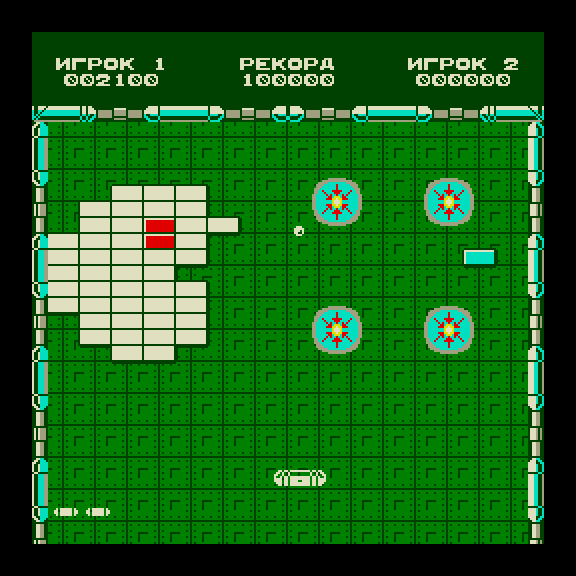
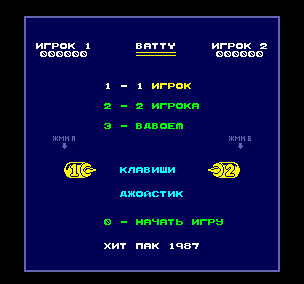

# Batty для Вектора-06Ц — цветная версия

Порт арканоида **Batty** (Hit-Pak, 1987) на обычный Вектор-06Ц: i8080 3 МГц, 64 КБ, без квазидиска. Игра собирается в ROM-файл и запускается в эмуляторах и на MiSTer.

| Раунд 1 | Раунд 14 | Меню (MiSTer) |
|---|---|---|
|  |  |  |

## Откуда эта версия

- Оригинал — Batty для ZX Spectrum, (C) 1987 Hit-Pak.
- Адаптация для ПК «Специалист» — Юдин С. А., 2020.
- Порт на Вектор-06Ц — Никита Зимин, [nzeemin/vector06c-batty](https://github.com/nzeemin/vector06c-batty). Это монохромная версия: игра выводится в окне ZX-экрана. Её история целиком сохранена в этом репозитории.
- Эта версия («c» в названии — color) продолжает тот порт: игра перерисована под цветной экран Вектора, логика оригинала сохранена.

## Чем отличается

**Экран и цвет**
- Экран в режиме «3+1»: три плоскости — фон до 8 цветов, четвёртая — белые спрайты поверх любого фона. Мячи, бонусы, враги и пули выводятся белыми, без теней.
- Поле во весь экран: счёт сверху, бита внизу, рамка с трубами и соединителями из ZX-версии.
- Кирпичи как в версии для Amstrad CPC; раунды идут в четырёх цветовых темах по кругу (синяя, зелёная, фиолетовая, красная).
- Магниты — цветные диски (голубое тело, красные стрелки, жёлтое ядро), включение и выключение рисуются из кэша.
- Заставка 256×256 из экрана загрузки ZX-версии (в `batty-splash.rom`).

**Игра и управление**
- Весь текст по-русски: меню, счёт («ИГРОК 1 / РЕКОРД / ИГРОК 2»), сообщения раунда и конца игры, таблица рекордов.
- Клавиатура и два джойстика «П». В режиме «Вдвоём» левый игрок на клавишах Вектора Ф (влево), Ы (вправо), А (огонь), правый — стрелки и пробел.
- Постоянная скорость: логика идёт ровно 50 шагов в секунду по таймеру ВИ53. Вывод — 50 раз в секунду в лёгких сценах и ровно 25 в тяжёлых (три мяча, бонус и враг одновременно).
- Отступление от оригинала: за бонус «5000» начисляется ровно 5000 очков (в оригинале 5400) и всплывает табличка «5000» (в оригинале — «400», как за любой бонус).

Подробности, замеры и причины решений — в [MERGE.md](MERGE.md), [MAGNETS.md](MAGNETS.md), [RUSSIAN.md](RUSSIAN.md) и других `*.md` в корне.

## Сборка

Нужны:
- [sjasmplus](https://github.com/z00m128/sjasmplus) (проверено на 1.24.0) — ассемблер, режим `--i8080`;
- [Node.js](https://nodejs.org/) (проверено на 26) — генераторы графики и проверки;
- POSIX-оболочка (`sh`).

```sh
git clone git@github.com:reqw41/battyc-v06c.git
cd battyc-v06c
SJASMPLUS=sjasmplus sh build-three-plus-one.sh
```

`SJASMPLUS` — путь к ассемблеру. Если его не задать, сценарий ищет `../sjasmplus/sjasmplus`.

Что делает `build-three-plus-one.sh`:
1. собирает стартовый блок `batty0.asm` (заставка, палитра, загрузка);
2. генерирует графику: `verify/generate-no-shadows.js` (спрайты без теней), `verify/generate-mono-assets.js` (спрайты в столбцы для вывода через SP), `verify/generate-zx-frame.js` (рамка поля);
3. собирает игру `batty.asm` с `-DNO_SPRITE_SHADOWS=1`;
4. склеивает `batty0.bin` и `batty8080.bin` в `batty.rom`;
5. `verify/make-splash-rom.js` добавляет заставку и выдаёт `batty-splash.rom`.

Результат:
- `batty.rom` — 32 512 байт, игра без заставки (на нём идут проверки);
- `batty-splash.rom` — 65 280 байт: вторая половина файла загружается прямо в экранную память, поэтому заставка видна сразу после загрузки.

Сборка воспроизводима: из чистого клона получаются побайтно те же файлы.

## Запуск

- **Emu80**: `Emu80qt --platform vector --run batty-splash.rom`.
- **MiSTer** (ядро Vector-06C): положить ROM в `games/VECTOR06/` и открыть его из меню ядра, либо сделать `.mgl`:
  ```xml
  <mistergamedescription>
   <rbf>_Computer/Vector-06C</rbf>
   <file delay="1" type="f" index="0" path="../../games/VECTOR06/batty-splash.rom"/>
  </mistergamedescription>
  ```
- На настоящем Векторе и с настоящими джойстиками «П» игра пока не проверялась.

## Проверки

Сценарии `verify/test-*.js` и замеры `verify/measure-*.js` гоняют ROM в эмуляторе [vector06js](https://github.com/svofski/vector06js). Путь к нему задаёт `VECTOR06JS_ROOT`:

```sh
VECTOR06JS_ROOT=/path/to/vector06js node verify/test-three-plus-one.js
```

Отчёты пишутся в `outputs/`. Сейчас проходят 27 проверок из 41; остальные падали и до последних правок (подробности — в `MERGE.md`). Часть проверок читает `../../outputs`, поэтому их удобно запускать из папки на глубине `wt/<имя>` внутри рабочей копии.

## Память

ROM занимает почти всё доступное место: в основной области кода свободно несколько байт. Карта памяти — в [THREE_PLUS_ONE.md](THREE_PLUS_ONE.md), состояние — в [MERGE.md](MERGE.md).
